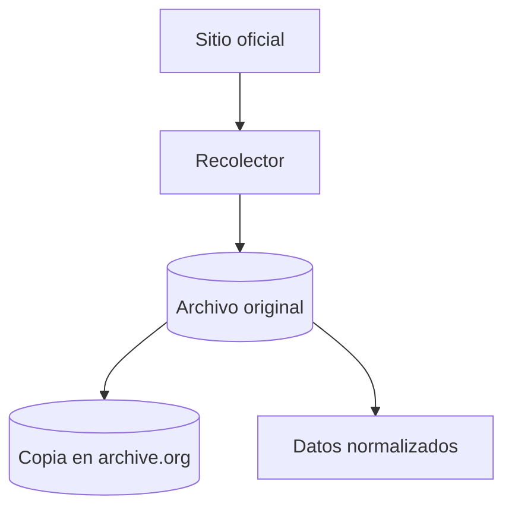

# CABA Transparente

**La Ciudad de Buenos Aires, con los números sobre la mesa.**

En qué gasta la Ciudad, a quién le compra y quién decide. Datos oficiales del Gobierno de la Ciudad Autónoma de Buenos Aires, guardados tal cual se publicaron, normalizados y con la fuente de cada número.

> Estado: en preparación. Hay datos de Buenos Aires Compras y una primera versión de la web para desarrollo local.

## Cómo funciona



1. **Recolector.** Un script por fuente en `packages/scrapers/src/sources/<id>.ts`.
2. **Archivo original.** Se guarda tal cual llegó en `data/raw/<fuente>/<fecha>/`, con su sha256 en `manifest.jsonl`. Los originales no van a git: viven en Cloudflare R2; los manifests sí van a git ([decisiones D-03 y D-05](docs/decisiones.md)).
3. **Copia en archive.org.** El original se sube a un ítem de archive.org y la Wayback Machine captura la URL oficial.
4. **Datos normalizados.** CSV en `data/processed/<fuente>/`, con su diccionario `<archivo>.meta.json`.

## Estructura

| Carpeta | Qué es |
|---|---|
| `apps/web` | `@ct/web`: el sitio (Vite, React y TanStack Router). Ver [docs/procesos/web.md](docs/procesos/web.md) |
| `packages/core` | `@ct/core`: descarga, archivado, CSV y archive.org |
| `packages/scrapers` | `@ct/scrapers`: un recolector por fuente y el copiado a archive.org |
| `sources.yaml` | Catálogo de fuentes |
| `data/` | `raw/` (originales), `processed/` (normalizados), `curado/` (contenido escrito a mano) |
| `docs/` | Decisiones, relevamiento de fuentes y procesos |

## Para empezar

Hace falta [Bun](https://bun.sh).

```bash
bun install
bun run dev                      # la web en http://localhost:5180 (arma antes sus datos)
bun run scrape <fuente> [args]   # correr un recolector
bun run archivar [fuentes...]    # copiar los originales a archive.org (necesita IA_ACCESS_KEY e IA_SECRET_KEY)
bun run typecheck
bun test
bun run lint
```

## Créditos y licencia

Código: [MIT](LICENSE). Datos procesados: [CC BY 4.0](https://creativecommons.org/licenses/by/4.0/deed.es). La infraestructura de descarga, archivado y copia en archive.org está adaptada de [Mendoza Transparente](https://github.com/unllamas/mendoza-transparente) (MIT); los archivos adaptados lo indican en su cabecera. Los datos originales pertenecen a sus organismos de origen.
