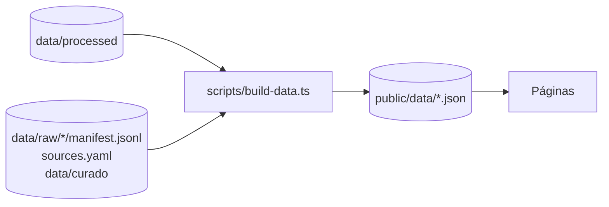

# La web

`apps/web`: React 19, Vite, TanStack Router y Tailwind 4 (decisión D-14).

## Cómo se arma



1. `scripts/build-data.ts` lee los CSV procesados, los manifests, `sources.yaml` y `data/curado/`, y escribe en `public/data/` un JSON por página. Todas las cuentas se hacen acá (`scripts/compras.ts`, `scripts/senales.ts`) y tienen pruebas (`scripts/compras.test.ts`).
2. Cada ruta de `src/main.tsx` carga su JSON (`loadData`) y la página lo muestra. Las páginas no suman ni filtran datos, salvo la búsqueda en las listas.
3. `public/data/` se genera en cada `dev` y cada `build` y no va a git.

## Desarrollo local

Los procesados no están en git (D-04, D-05). Si este checkout no tiene `data/processed/`, se apunta a otro con `CT_DATA_DIR`. Acepta varias carpetas separadas por `:`, y cada fuente se lee de la primera que la tenga; el `data/` de este checkout siempre va al final:

```bash
bun run dev                                                # usa data/ de este checkout
CT_DATA_DIR=~/projects/caba-transparente/data bun run dev   # p. ej. desde un worktree
bun run scrape indec-ipc                                   # IPC para los pesos constantes
bun run scrape bcra-cotizaciones                           # dólar y euro para los gráficos por año
bun run web:datos                                          # solo regenerar public/data
bun run web:build                                          # build de producción en apps/web/dist
```

Una fuente sin procesados deja sus páginas vacías (404), sin romper el resto. El build pregunta a R2 (un pedido por fuente) si sus procesados ya están publicados: si no, `/datos` los lista sin enlace de descarga y las páginas no enlazan a R2.

## Reglas

- **Cada número con su fuente.** Toda página con cifras termina con `SourceNote`: fuente oficial, fecha de descarga y enlace a los procesados en R2. Cada compra enlaza a su pliego o documento en Buenos Aires Compras.
- **Lo adjudicado no es lo gastado, dicho en la página.** BAC registra cada contrato por su monto total en el año en que se adjudica, aunque dure varios años, y no trae redeterminaciones, ampliaciones, rescisiones ni pagos. Los gráficos por año se llaman «Contratos adjudicados por año» y lo aclaran; «Cómo leer» lo explica con los picos de 2018 y 2023.
- **Pesos de cada año o constantes, dicho en la página.** Cada monto de compras viaja en las dos unidades (`montoArs` y `montoReal`) y la persona elige con «Montos en» (`src/pesos.tsx`); la elección se guarda en el navegador. Los pesos constantes salen del IPC de INDEC (D-15) y solo cubren desde 2017. Las compras puntuales (listas de recientes) van siempre en pesos de su fecha. Las otras monedas solo se convierten en los gráficos por año (barra apilada, con la cotización del BCRA del mes de cada adjudicación, D-16); en totales y rankings van aparte, en su moneda.
- **Personas humanas solo en totales** (AGENTS.md, D-04). No tienen ficha, ni fila en las listas, ni nombre en las señales. Los títulos ocultos se muestran como «Título oculto: nombra a un paciente».
- **Boletín: solo el índice de la API.** Nombre, tipo, organismo, sumario y enlace de cada norma. Los sumarios que el recolector ocultó (edictos, DNI o CUIL, carátulas de causas) no llegan a la web; nada sale del texto de los PDF.
- **Señales, no acusaciones.** Cada señal dice cómo se calculó, lista sus casos y trae su matiz. Los umbrales están en `scripts/senales.ts`.
- Textos de la web en español rioplatense; código y comentarios en inglés.

## Pendiente

- Repartir cada contrato entre los años de su vigencia (BAC trae inicio y fin), como alternativa al año de adjudicación.
- Páginas pre-generadas para buscadores y título por página (D-06).
- Bajar los procesados desde R2 en el build, para construir en Cloudflare o en GitHub Actions sin `data/processed/` local.
- Más ediciones del Boletín: hoy hay solo las que están en `data/processed/boletin-oficial/` (octubre de 2026). Su recolector todavía no está en `main` (PR #7).
